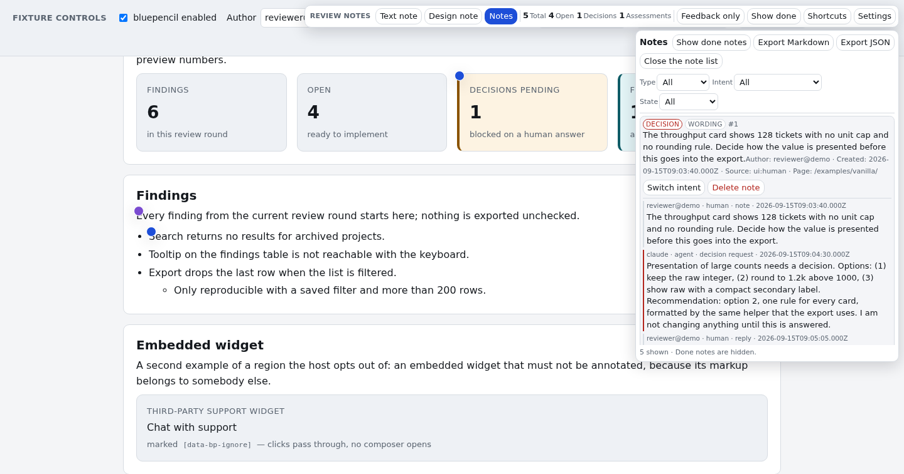
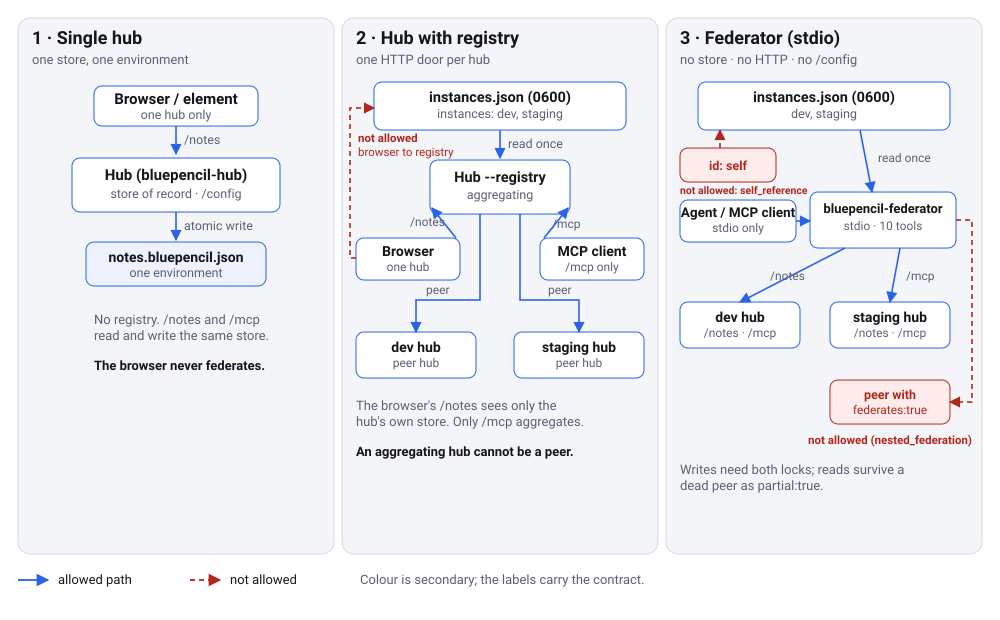
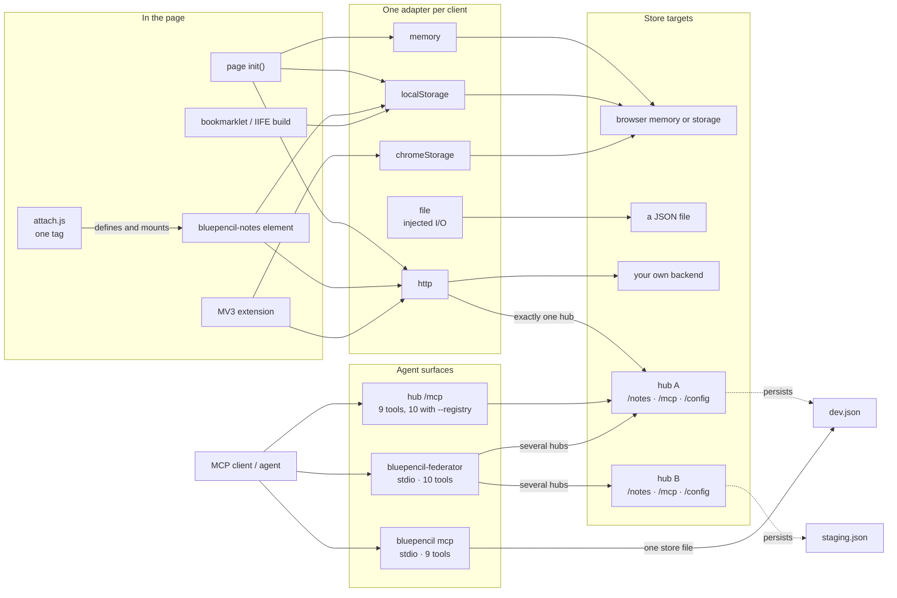
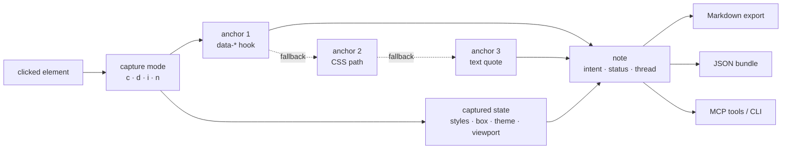

# bluepencil

> **Annotate any web app — text and design notes, anchored to the element, readable by humans *and* agents.**

bluepencil injects a review layer into a running web application: click any element, leave a note
about its **content** or its **appearance**, and hand the whole set to a developer or an AI agent —
no screenshots, no prose descriptions, no "the second badge in the header". It is a
framework-agnostic TypeScript library with **no runtime dependencies** and one headless data layer
shared by UI, CLI, hub and MCP.



## Contents

| Section | What you find |
|---|---|
| [Status](#status) | What `0.11.5` contains — and what it honestly does not |
| [Why the name](#why-the-name) | Where the metaphor comes from |
| [Quick start](#quick-start) | Build, artifact table, one `init()` call, the runtime handle |
| [The pieces](#the-pieces) | Browser layer, five adapters, store, hub, two agent doors |
| [Deployment shapes](#deployment-shapes) | Five ways to run it, from solo to hub of hubs |
| [Ways to put it on a page](#ways-to-put-it-on-a-page) | Loader options and the adapter switch |
| [Connecting an agent](#connecting-an-agent) | MCP clients, 9-vs-10 tools, write locks |
| [Capture modes](#capture-modes) | `c` / `d` / `i` / `n`, the host ceiling, Alt+click |
| [The browser extension](#the-browser-extension) | MV3 on pages you do not build |
| [Verify and release](#verify-and-release) | Gates, smoke matrix, how a release is cut |
| [Documentation](#documentation) | Where the detail lives |
| [What it will be](#what-it-will-be) | The design in one page |
| [Non-negotiables](#non-negotiables) | The promises the code keeps |
| [Privacy and secrets](#privacy-and-secrets) | What leaves the page, and what never does |
| [License](#license) | MIT |

## Status

**`0.11.5`** — the review layer, the headless data library and the CLI/MCP surfaces are on `main`.
This patch hardens the optional admin surface introduced in `0.11.0`: the minted-token panel, the
notes-only credential bridge, durable revocation, request limits and the page's own headers. What is
in the tree:

- **The layer** — core model, anchoring (now including **transient container reveal**), capture,
  store and the five adapters (with a conformance suite); Markdown/JSON export; the collaboration
  protocol; the review layer with i18n and **four capture presets** (`text`, `design`, `bug`,
  `feature`), optional feature **priority**, per-mode visibility with a host ceiling (`modes`),
  Alt+click annotation of interactive elements and a visible version line; the public API and the
  `<bluepencil-notes>` element.
- **The headless core** — canonical, diffable bundles with `merge` / `upsert` /
  `replace-session` and migrations, plus the CLI, so CI and agents use the same data and
  validators as the UI.
- **The agent doors** — the MCP server (read-only by default) and the **hub**: one command, static
  site and notes API on one port, **MCP over HTTP** so an agent reaches the same notes the browser
  writes, per-device signed tokens (shared secret or token, per-environment and revocable), a
  `GET {base}/config` that describes the running process without a credential, and a container
  image (`docker compose up -d`) that generates its own credential.
- **The admin surface (optional)** — `{base}/admin` with `--admin-secret` (or
  `BLUEPENCIL_ADMIN_SECRET`): mint and revoke per-device tokens, read status and devices, and edit
  notes through a notes-only bridge. It is off by default and answers the ordinary 404 without the
  flag.
- **The extension** — a **Chromium MV3 extension** that mounts the layer in pages you do not build
  yourself, with its settings reaching the layer and its rounds kept in the extension's own storage.
- **Dictation** — **opt-in composer dictation** (`voice`, off by default — a mic button that
  appends the browser's transcript without saving it).
- **Federation (`0.10.0`)** — federation as an **agent-side layer**: a registry, an aggregating hub
  (`--registry`) and a separate stdio **federator** for one agent over several hubs. Browsers never
  federate — a browser still writes to exactly one hub.
- **Proof in the tree** — the vanilla fixture app, the unit suite and the browser legs of the embed,
  end-to-end, round-trip, bookmarklet, parity, extension and federation smokes; `smoke:components`
  binds those surfaces into one matrix, while `smoke:auth`, `smoke:hermes`, `smoke:voice` and
  `smoke:docker` cover the auth gate, the Hermes wrapper, dictation and the container/Compose
  shape.

### Known gaps

- **Federation.** There is **no cross-instance session merge** (each note keeps its own session);
  the aggregate is always bounded by `limit`; the extension has **one hub profile**, not a list;
  hubs older than `0.10` are not federatable and are refused with `federates_missing`, never
  silently reported as "no notes"; and `unverified` appears only when a peer's `/config` omits
  `app` — a missing `federates` is a start error, not a warning.
- **Distribution.** No npm publish — install from the tag
  (`npm i github:Popoboxxo/bluepencil#v0.11.5`; the `prepare` script builds `dist/` during
  install) or use the release artifacts: loader, layer, package tarball, the MV3 browser
  extension, one `SHA256SUMS` over all of them, and the hub image on
  `ghcr.io/popoboxxo/bluepencil` ([docs/DOCKER.md](docs/DOCKER.md)).
- **Operations.** Revocation is live through the admin surface when `--revoked-tokens` is
  configured (and durable across restarts); without that file it is lost on restart. Token refresh
  remains manual.
- **Testing.** The E2E suite is hand-rolled over the CDP pipe rather than Playwright (NFR-4 says no
  test framework).
- **Dictation.** It leans on the browser's own Web Speech API (Chromium/Safari only — no Firefox;
  Chromium may send audio to a browser service, so inject `voiceEngine` to stay offline).
- **UI.** No import/merge surface; no bulk delete or retention control; i18n only `en`/`de`.

How a release is cut: [docs/RELEASING.md](docs/RELEASING.md). Milestones and their state are
tracked in [docs/REQUIREMENTS.md](docs/REQUIREMENTS.md), the history in
[CHANGELOG.md](CHANGELOG.md). This repository is the home of the library; the interaction model
itself is already proven in a production-used prototype (see
[docs/CONCEPT.md](docs/CONCEPT.md#7-proven-prior-art)).

## Why the name

To *blue-pencil* something means to edit it — marking up a draft with corrections and suggestions.
That is exactly what this overlay does: it is the blue pencil you hold against a running
application instead of a screenshot.

## Quick start

There is no npm release yet — build it from the repository. The library itself has **no runtime
dependencies**; the dev dependencies are for the build and the tests only.

The toolchain needs **Node 22.22.2+, 24.15+ or 26+** — that is the range `jsdom` 30 declares
(`^22.22.2 || ^24.15.0 || >=26.0.0`). On an older release `npm ci` prints `EBADENGINE` warnings for
the test dependencies, and the suite may die inside one of them with a message that names neither
Node nor Vitest.

```bash
npm install              # dev dependencies; the `prepare` script then builds dist/
npm run build            # re-run it after changing src/
node scripts/serve-example.mjs
# open http://localhost:9283/examples/vanilla/
```

### Artifacts

`npm run build` writes the artifacts below; which one a host needs depends on how it loads code:

| Artifact | Host type | Entry |
|---|---|---|
| `dist/bluepencil.js` (with `dist/data.js`, `dist/adapters/*.js`, `dist/i18n/*.js`) | npm dependency / bundler | the package entry — `import { init } from "bluepencil"` |
| `dist/bluepencil.iife.js` | classic `<script>` tag, bookmarklet | global `bluepencil` |
| `dist/bluepencil.element.js` and `.min.js` | no-build host: one ES module resource (static page, CMS, Home Assistant) | defines `<bluepencil-notes>` |
| `dist/bluepencil.element.iife.js` | classic script — the browser extension's MAIN world | global `bluepencilElement` |
| `dist/attach.js` (classic) and `dist/attach.esm.js` (bundler) | the one-tag attach loader | `window.bluepencilAttach` |
| `dist/cli.js` | CLI in CI, scripts and offline exchange | `bluepencil …` (or `node dist/cli.js …`) |
| `dist/mcp.js` | MCP server over stdio, one store, read-only by default | `node dist/mcp.js --store …` |
| `dist/server.js` | the reference hub: static site *and* notes API on one port | `node dist/server.js --store …`, bin `bluepencil-hub` |
| `dist/federator.js` | MCP server over stdio across several hubs; **no store of its own** | `bluepencil-federator --registry …` |
| bin `bluepencil-hub` → `dist/server.js` | the hub under its installed name | `bluepencil-hub --store …` |
| bin `bluepencil-federator` → `dist/federator.js` | the federator under its installed name | `bluepencil-federator --registry …` |

`dist/bluepencil.js` is the code-split ES module build — the `chunk-*.js` files next to it are its
internals, not entry points. `dist/bluepencil.core.js` is the NFR-3 size measurement (the built-in
adapters aliased away), not something a host loads. `dist/types/**` holds the `.d.ts` declarations
for every entry. The package declares three bins: `bluepencil`, `bluepencil-hub` and
`bluepencil-federator`.

### The fixture app

The fixture page is a small dashboard that carries every requirement group — annotate text and
design, select a quote, filter, reveal done notes, switch feedback-only mode, answer a decision
thread, export Markdown/JSON. Bulk delete (FR-8.2) and session purge (FR-8.3) are M2 work and have
no control in the fixture. The checklist for a manual round is in
[examples/vanilla/README.md](examples/vanilla/README.md).

### Put it on your page

On your own page it is one call — with the classic build from the table above (a bundler host uses
`import { init } from "bluepencil"` instead and has no global):

```html
<script src="/dist/bluepencil.iife.js"></script>
<script>
  bluepencil.init({
    enabled: () => me.roles.includes("admin"),   // re-checked on every enable(); fail closed
    adapter: "localStorage",                     // or createHttpAdapter({ endpoint: "/api/v1/bluepencil" })
    getRoute: () => location.pathname + location.search,
  });
</script>
```

Under a strict Content-Security-Policy the page needs the script URL in `script-src` **and** the hub
origin in `connect-src`: `script-src` alone does not govern `fetch()`, and `default-src 'self'` with
no `connect-src` mounts the layer and then blocks every hub call. Recipes for both the explicit and
the `default-src`-only form are in
[EMBED.md §2](docs/EMBED.md#csp-script-src-and-connect-src).

### The runtime handle

`init()` returns a handle the host can switch at runtime, without a reload:

```ts
const bp = init({ enabled: () => flags.uiNotes, adapter: "localStorage" });

bp.enable();                        // attach the layer
bp.disable();                       // remove nodes, listeners, styles — idempotent
bp.export({ format: "markdown" });  // the agent-facing export
await bp.destroy();                 // final cleanup
```

Next stops: [docs/INTEGRATION.md](docs/INTEGRATION.md) for the modes, host hooks, theming and the
admin debug pattern; [docs/ARCHITECTURE.md](docs/ARCHITECTURE.md#2-public-api-sketch) and
[docs/INTERNAL-API.md](docs/INTERNAL-API.md) §9 for the full API.

## The pieces

bluepencil is not one program. It is a browser layer, a headless data library, a CLI, an MCP stdio
server, a hub and a federator — and the piece you pick decides where the notes live and who can
read them.



The diagram below is the adapter cut: the browser clients all plug into the same five adapters, and
the agent surfaces split into exactly two kinds — one store (9 tools) or a federation (10 tools).



| Client | Store | Network | Visible to agents |
|---|---|---|---|
| `init()` in your page script | the adapter you pass (`memory` by default) | none, or the one endpoint that adapter names | only when that store is a hub, or a file an agent can read |
| `<bluepencil-notes>` element | the same adapters, selected by attributes | same as above | same as above |
| `attach.js` (one tag) | the element it creates, so the same adapters | same as above | same as above |
| bookmarklet / IIFE build | `localStorage` by default | none by default | only after an export |
| MV3 extension | `chromeStorage`, the page, the tab, or one hub | the hub only when selected | the hub, yes; the local stores, no |
| `bluepencil mcp` (stdio) | one store file | none | it *is* the agent surface |
| `bluepencil` CLI | a store file or a bundle | none | writes the file or bundle an agent later reads |
| `bluepencil-hub` | one store file (optionally a registry) | one HTTP port: `/notes`, `/mcp`, `/config` | yes, over `/mcp` |
| `bluepencil-federator` | none — reads its peers | HTTP to every registry peer | yes, over stdio |
| your own backend | your database | your HTTP API | yes, if it serves the store contract or you export from it |

A **store** is one note set: a JSON file, a browser storage area, or your database. A **hub** adds
one HTTP door in front of one store, so a browser and an agent read and write the same notes.
**Federation** adds nothing to the browser: a separate agent-side process reads several hubs and
presents them as one session. Browsers never join a registry, and `instance` is never a browser
attribute — `environment` is.

## Deployment shapes

The five shapes below cover the range from "one reviewer, no server" to "one agent, several
environments". Every snippet is meant to be copied; the deeper document has the full contract.

| # | Shape | You need | Who reads the notes |
|---|---|---|---|
| 1 | Solo, no backend | nothing beyond the page | the browser; export by hand |
| 2 | Embedded with your own backend | an HTTP API that serves the store contract | your app, and any agent you hand a bundle or an `/mcp` door to |
| 3 | Self-hosted hub, one store | Docker (or `bluepencil-hub`) | a browser and an agent, same store |
| 4 | Hub of hubs | two leaf hubs plus a registry | an agent; each browser still writes one leaf |
| 5 | Offline exchange | the CLI | whoever receives the bundle |

```mermaid
flowchart TB
  subgraph shape1["1 · Solo, no backend"]
    p1["your page + layer"] --> a1["memory / localStorage"]
  end

  subgraph shape2["2 · Embedded, own backend"]
    p2["your page + http adapter"] --> b2["your backend"]
    b2 --> db2["your database"]
    ag2["agent"] -.->|"bundle, or an /mcp door you add"| b2
  end

  subgraph shape3["3 · Self-hosted hub"]
    p3["browser"] -->|"/notes"| h3["bluepencil-hub"]
    p3 -.->|"/config · /health"| h3
    ag3["agent"] -->|"/mcp"| h3
    h3 --> st3["dev.json"]
  end

  subgraph shape4["4 · Hub of hubs"]
    p4["browser"] -->|"/notes"| hd4["hub-dev"]
    p5["browser"] -->|"/notes"| hs4["hub-staging"]
    hd4 --> d4["dev.json"]
    hs4 --> s4st["staging.json"]
    ag4["agent"] -->|"stdio"| f4["federator"]
    ag5["agent"] -->|"/mcp"| agg4["aggregating hub"]
    f4 -->|"/config · /mcp"| hd4
    f4 -->|"/config · /mcp"| hs4
    agg4 -->|"/mcp"| hd4
    agg4 -->|"/mcp"| hs4
  end

  subgraph shape5["5 · Offline exchange"]
    p6["browser or hub"] -->|"export"| bd5["bundle JSON"]
    bd5 -->|"merge / import"| cl5["bluepencil CLI"]
    cl5 --> st5["store file"]
  end
```



### 1. Solo, no backend

The smallest round: no server, no account, and nothing leaves the browser. `memory` is the default
and loses the round on reload, so choose `localStorage` when it must survive one.

```html
<script src="/dist/bluepencil.iife.js"></script>
<script>
  bluepencil.init({
    adapter: "localStorage",             // "memory" is the default: gone on reload
    getRoute: () => location.pathname + location.search,
  });
</script>
```

A `localStorage` round is namespaced per origin and can be exported as Markdown or a bundle. It is
invisible to every agent until you export it. Deeper:
[docs/INTEGRATION.md §3](docs/INTEGRATION.md#3-embedded-local-only).

### 2. Embedded with your own backend

You keep the data; bluepencil only speaks the documented store contract. Any backend that implements
`{base}/notes`, `{base}/notes/{id}`, `{base}/notes/{id}/messages`, `{base}/sessions` and
`{base}/health` works — the adapter maps transport only and adds no business logic.

```ts
import { init } from "bluepencil";
import { createHttpAdapter } from "bluepencil/adapters/http";

const bp = init({
  enabled: () => currentUser.roles.includes("admin"),
  adapter: createHttpAdapter({
    endpoint: "/api/bluepencil",                        // the base, not the /notes path
    headers: () => ({ Authorization: `Bearer ${getToken()}` }),
  }),
  identity: { getUser: () => ({ id: currentUser.id, name: currentUser.displayName }) },
  getRoute: () => location.pathname + location.search,
});
bp.enable();
```

The endpoint is the base URL: the adapter appends `/notes`, `/notes/{id}`, `/notes/{id}/messages`,
`/sessions` and `/health`. Deeper:
[docs/INTEGRATION.md §2](docs/INTEGRATION.md#2-embedded-http-adapter) and
[docs/EMBED.md §4](docs/EMBED.md#4-the-store-contract).

### 3. Self-hosted hub, one store

One container, one store, one environment. The browser and the agent use different doors of the same
process: `/notes` for the page, `/mcp` for the agent, `/config` to describe it without a credential
(name, app, environment, federates).

```yaml
services:
  hub:
    image: ghcr.io/popoboxxo/bluepencil:0.11.5
    ports: ["127.0.0.1:8787:8787"]
    volumes: ["bluepencil-notes:/data"]
    environment:
      BLUEPENCIL_NAME: dev-hub
      BLUEPENCIL_STORE: /data/dev.json
      BLUEPENCIL_APP: my-web-tool
      BLUEPENCIL_ENVIRONMENT: dev
      BLUEPENCIL_AUTH_SECRET: "${BLUEPENCIL_AUTH_SECRET:?set one}"
volumes:
  bluepencil-notes:
```

```bash
export BLUEPENCIL_AUTH_SECRET="$(openssl rand -hex 32)"
docker compose up -d
curl -s http://127.0.0.1:8787/api/v1/bluepencil/config
```

```html
<bluepencil-notes
  endpoint="http://127.0.0.1:8787/api/v1/bluepencil"
  environment="dev"
  app="my-web-tool"
  session="review-2026-10-23"></bluepencil-notes>
```

The same process without Docker is `bluepencil-hub --store ./dev.json --app my-web-tool
--environment dev --host 127.0.0.1 --port 8787`. Deeper: [docs/DOCKER.md](docs/DOCKER.md).

### 4. Hub of hubs

Federation here is one level: leaf hubs stay exactly as in shape 3, and one aggregator makes their
`/mcp` doors look like one session. The browser never talks to the aggregator; it keeps writing to
its own leaf.

```bash
cd examples/federation
cp .env.example .env
printf 'BP_DEV_TOKEN=%s\nBP_STAGING_TOKEN=%s\n' \
  "$(openssl rand -hex 32)" "$(openssl rand -hex 32)" >> .env
chmod 600 .env
chmod 600 instances.json      # any group/world bit is invalid_registry
# host uid != 1000: set BLUEPENCIL_UID/BLUEPENCIL_GID in .env and let that user own instances.json
docker compose up -d
docker compose logs -f hub-aggregator
```

The registry is the whole configuration. Bases are **API bases**, including `/api/v1/bluepencil`:

```json
{
  "schemaVersion": 1,
  "defaults": { "includeSelf": false, "timeoutMs": 3000, "concurrency": 4, "limit": 200 },
  "instances": [
    { "id": "dev",     "base": "http://hub-dev:8787/api/v1/bluepencil",
      "mode": "read", "auth": { "env": "BP_DEV_TOKEN" } },
    { "id": "staging", "base": "http://hub-staging:8787/api/v1/bluepencil",
      "mode": "read", "auth": { "env": "BP_STAGING_TOKEN" } }
  ]
}
```

The full file, with the container names this compose project uses, is
[examples/federation/instances.json](examples/federation/instances.json).

```yaml
# hub-aggregator, from examples/federation/docker-compose.yml
entrypoint: ["/usr/local/bin/bluepencil-hub"]
command: ["--store", "/tmp/aggregator.json", "--host", "0.0.0.0", "--port", "8787",
          "--base", "/api/v1/bluepencil", "--name", "hub-aggregator", "--app", "my-web-tool",
          "--registry", "/etc/bluepencil/instances.json",
          "--no-self", "--read-only", "--allow-insecure"]
```

`--allow-insecure` is required because the peers are plain `http` on a private Docker network; it
still blocks link-local and cloud-metadata targets. The aggregator publishes only
`127.0.0.1:8790`, and its own store is intentionally empty, so `--no-self` keeps `self` out of the
aggregate. A refused start exits `4` (`invalid_registry`, `invalid_base_url`, `federates_missing`,
`self_reference`, `nested_federation`, `identity_mismatch`, `missing_credential`); an unreachable
peer does not stop the session — the aggregate is `partial: true` and `bluepencil instances health`
exits `5`. Check a registry before starting anything with
`bluepencil instances validate --registry ./instances.json --allow-insecure`.

The federator is **stdio only** and is not a compose service. A client starts it per session:

```bash
docker run -i --rm --network bluepencil-federation \
  --user "$(id -u):$(id -g)" \
  --env-file .env \
  --no-healthcheck \
  -v "$PWD/instances.json:/etc/bluepencil/instances.json:ro" \
  ghcr.io/popoboxxo/bluepencil:0.11.5 bluepencil-federator \
  --registry /etc/bluepencil/instances.json --read-only --allow-insecure
```

`--env-file .env` reads the registry credentials from the Compose `.env` file (uncomment and fill the
token lines in `.env.example`); `--no-healthcheck` turns off the image's `HEALTHCHECK`, which probes
the hub's `/health` — a federator has no HTTP endpoint and would otherwise sit at `unhealthy`
forever.

Deeper: [docs/FEDERATION.md §14](docs/FEDERATION.md#14-deployment-shapes).

### 5. Offline exchange

A bundle is the exchange format: schema-versioned JSON with an environment tag, validated and
merged by the same code the UI and MCP use. Rehearse first; a conflict refuses the write instead of
overwriting.

```bash
# 1. take a dev set out of a store as a portable bundle
bluepencil export dev.bluepencil.json --format json --out review.bundle.json

# 2. rehearse against the target: report conflicts, write nothing
bluepencil merge team.bluepencil.json review.bundle.json --dry-run --json

# 3. apply only after the report is clean (both sides are dev)
bluepencil import review.bundle.json team.bluepencil.json --mode upsert --on-conflict keep-incoming

# 4. promote dev → live deliberately: --environment re-tags the incoming notes
bluepencil merge live.bluepencil.json dev.bluepencil.json \
  --environment live --allow-env-mismatch --out live.promoted.json
```

`--mode` is `merge`, `upsert` or `replace-session`; an unresolved conflict exits `2` and writes
nothing. Deeper:
[docs/PROTOCOL.md §8](docs/PROTOCOL.md#8-environments-and-exchange-fr-14).

## Ways to put it on a page

Getting the layer *in* and deciding where the notes *live* are two separate choices, and the second
one is what makes a round local to one browser or shared with a server.

| How it gets in | What you add | Works when |
|---|---|---|
| **npm dependency** | `import { init } from "bluepencil"`, with `bluepencil/data`, `bluepencil/element`, `bluepencil/attach` and `bluepencil/adapters/*` as subpaths | you own the app and build it: tree-shaken, and a host pays only for the adapter it uses |
| **Classic `<script>`** | `dist/bluepencil.iife.js` → global `bluepencil` | a page with no build step of its own |
| **One tag, any host** | `dist/attach.js` plus `data-*` attributes; it defines `<bluepencil-notes>` and mounts it | static page, CMS, Home Assistant resource — nothing to build, nothing to call |
| **The element alone** | `dist/bluepencil.element.min.js` and a `<bluepencil-notes …>` tag you place yourself | you want to control when and where it mounts, and to read its events |
| **Bookmarklet** | a bookmark pointing at the IIFE build | the page is not yours and you cannot deploy it — see the CSP notes in [INTEGRATION §4](docs/INTEGRATION.md#4-bookmarklet-no-deploy) |
| **Self-hosted hub** | `bluepencil-hub --store notes.json --root <dir>` | you want persistence and one shared store without writing a backend |
| **Hub with a registry** | `bluepencil-hub --store … --registry ./instances.json` | one hub whose `/mcp` door also reads leaf hubs — see [Deployment shapes](#deployment-shapes) |
| **Chromium extension** | load `extension/dist` unpacked — see [the next section](#the-browser-extension) | any page, without editing it |
| **Headless** | the `bluepencil` CLI, `node dist/mcp.js`, `bluepencil/data` | CI, scripts and agents, against the same data and validators as the UI |
| **Agent over several hubs** | `bluepencil-federator --registry ./instances.json` | one agent session must read and write several hubs; no browser involved |

Where the notes land is a separate switch, the adapter:

| Adapter | Survives | Notes |
|---|---|---|
| `memory` | nothing — it is the default | the layer is an overlay, not a store |
| `localStorage` | a reload, in that browser | namespaced `bluepencil:<host>:<instance>:v1` (`<instance>` is a store key, not a browser attribute); the bookmarklet's default; partitioned per origin |
| `chromeStorage` | a reload, in that browser profile, across every site | the extension's default, and the reason that adapter exists |
| `file` | whatever the host's I/O does | needs an injected `{ read, write }` — `createFileAdapter({ … })`, because there is no sensible default file to write to |
| `http` | a server | speaks the documented contract, so *any* backend works; `bluepencil-hub` implements it |

An HTTP store is also what makes a round visible to the MCP server, and the contract is small on
purpose — ten endpoints, listed in [docs/EMBED.md](docs/EMBED.md#4-the-store-contract), which is also
where the attribute table, the loader API and the update manifest live.

## Connecting an agent

Any MCP client works. Read the two paths as "one store" and "several hubs": `bluepencil mcp` serves
one file, `bluepencil-federator` serves a registry, and a hub with `--registry` serves the same
aggregate over HTTP. The full contract — tools, arguments, errors, strict flags — is
[docs/MCP.md](docs/MCP.md).

| Client | How to attach | Notes |
|---|---|---|
| **Any MCP client (stdio)** | spawn `bluepencil mcp --store … --environment dev --app …`, or `bluepencil-federator --registry …`, with an argv array | the normative shape; read-only by default |
| **Claude Desktop** | an entry in `claude_desktop_config.json` | restart the app after editing |
| **opencode** | an `mcp` entry in `opencode.json` or the global config | `"type": "local"`, `command` as an array |
| **Hermes** (one example) | the wrapper plus `BLUEPENCIL_*` environment variables | nothing in bluepencil requires Hermes; worked example in [docs/HERMES.md](docs/HERMES.md) |
| **Custom / HTTP hub** | `POST {base}/mcp` with JSON-RPC 2.0 | no sessions, no SSE; one JSON answer per request |

A single-store stdio session exposes **9** tools. A federation surface exposes **10** — the same set
plus `list_instances`; a federation exposes **no resources**. A hub without `--registry` exposes the
same 9 tools; a hub with `--registry` aggregates only on `/mcp`, while `/notes` stays local.

```json
{
  "mcpServers": {
    "bluepencil": {
      "command": "bluepencil",
      "args": ["mcp", "--store", "/srv/reviews/dev.bluepencil.json",
               "--environment", "dev", "--app", "my-web-tool"]
    },
    "bluepencil-federation": {
      "command": "bluepencil-federator",
      "args": ["--registry", "/srv/reviews/instances.json"]
    }
  }
}
```

Both are **read-only by default**. A write needs `--allow-write`, and only three spellings enable it:
`--allow-write`, `--allow-write=true`, or `BLUEPENCIL_ALLOW_WRITE=1` for the stdio single store.
`--allow-write=false` (or `--allow-write false`) leaves writes off; an unparsable value —
`--allow-write 1`, `--allow-write 0`, `--allow-write=yes` — is a usage error (exit `1`). A federated
write needs **two** locks: `mode: "write"` on the target instance **and** `--allow-write` on the
session. `--read-only` wins over both.

### Exit codes

| Code | Meaning |
|---|---|
| `0` | Success. The stdio servers also exit `0` on stdin EOF. |
| `1` | Usage error: unknown flag, malformed boolean, missing `--store` or `--registry`. |
| `2` | Unreadable or invalid store (stdio and hub); a CLI `merge` conflict refuses with `2` and writes nothing. |
| `4` | Start or refused operation: invalid registry or base URL, identity/start failure, `mode_denied`, `read_only`, `unknown_instance`, `instance_required`, `fanout_denied`, `environment_mismatch`, `not_found`. |
| `5` | Partial or degraded: `timeout`, `instance_unreachable`, `partial`, `invalid_response`, `not_persisted`; `instances health` also uses `5` for an unhealthy or unverified instance. |

`unverified` is the documented exception: health `5`, but runtime `0` — the instance is usable and
the warning does not fail the command.

## Capture modes

A capture mode says what a click *means*. The bar offers four, each with its own shortcut:

| Mode | Key | What is captured |
|---|---|---|
| **Text** | `c` | text capture — the selection quote, no captured state |
| **Design** | `d` | design snapshot — computed styles, box, theme, viewport |
| **Bug** | `i` | design snapshot **plus severity** (`blocker`, `major`, `minor`); always design, even on a text element |
| **Feature** | `n` | hybrid — text capture with a quote when a text target is found, otherwise a design snapshot; **plus priority** |

`priority` is optional and meaningful only on a `feature` note (`high`, `medium`, `low`); it is
omitted on every other type. A bug defaults to `intent=implement` like any work item, and the
feedback-only toggle overrides that as usual.



The host sets the ceiling: `init({ modes: ["text", "design", "bug"] })` or the element attribute
`modes="text,design,bug"`. An absent `modes` means all four; `modes="none"` mounts a read-only layer
that still shows the bar, list, filters, legend and settings but offers no capture. Inside that
ceiling the user can switch each mode off in the settings popover — a disabled mode hides its button,
inerts its shortcut and leaves existing notes untouched. Disabling the active mode falls back to
`off`; with every mode off the layer is read-only. **Alt+click** on an interactive element (button,
link, form field, interactive ARIA role) opens the composer in any active mode while a normal click
stays the host's own behaviour; `[data-bp-ignore]` and `canAnnotate` still veto.

## The browser extension

The MV3 extension mounts the same layer the attach tag does, on any page, without editing that page.
It is the only mode whose configuration is a UI instead of markup.

### What you need

* A Chromium-based browser, **Chrome 116 or newer** — `minimum_chrome_version` in
  `extension/manifest.json`.
* A built library first: the extension loads `dist/bluepencil.element.iife.js` verbatim, so
  `npm run build:ext` refuses to run without it.

```sh
npm run build && npm run build:ext     # writes extension/dist/
```

Then `chrome://extensions` → *Developer mode* → *Load unpacked* → `extension/dist`.

From a release you build nothing: every push to `main` attaches the packaged extension as a workflow
artefact, and a `v*` tag attaches `bluepencil-extension-<version>.zip` to the release. That zip is the
content of `extension/dist`, which is exactly what *Load unpacked* takes — see
[docs/RELEASING.md](docs/RELEASING.md).

### What it does

* The toolbar button (**Alt+Shift+B** by default, rebindable under `chrome://extensions/shortcuts`)
  mounts the layer on the tab you are looking at. Nothing runs on a page you did not ask for.
* The options page has *Turn on here* / *Turn off here* for the current tab. Switching off sets the
  element's `enabled="false"` rather than removing it, so open notes survive and the layer comes back
  without a second injection.
* A page can drive the same path instead of the toolbar, which is how a host app offers its own
  "annotate this page" button:

```js
window.postMessage({ source: "bluepencil-page", kind: "request-mount" }, window.location.origin);
// kind: "toggle" with { enabled: false, requestId: "1" } switches it; the reply arrives on the same
// channel tagged with your requestId — read it in a later turn, never by awaiting inside the same one.
```

* The layer mounts in the page's **MAIN world**, because an isolated content-script world has no usable
  `customElements` to register the element in. That is also why the extension does **not** get around
  a page's CSP: the layer works *inside* the policy (falling back to constructable stylesheets when
  `style-src` forbids inline styles), it does not bypass it. One exception since 0.11.6: **hub
  traffic** is relayed through the extension's service worker and is outside the document's
  `connect-src`. The loader's own manifest/asset fetches are still subject to the policy, and a page
  that runs without the extension always needs `connect-src` for the hub — see
  [docs/EXTENSION.md](docs/EXTENSION.md#an-extension-does-not-bypass-a-csp).

### Settings

The options page writes one object into `chrome.storage.local` (key `bluepencil:settings`), which the
service worker reads on every mount. `extension/src/settings.ts` validates it field by field, so a
hand-edited or older blob cannot put the layer into a state the worker would reject, and an unknown
value is replaced by the documented default rather than stored.

| Field | Values | What it decides |
|---|---|---|
| Environment | `dev`, `staging`, `live` | the badge the layer shows on each note. A stored `prod` is migrated to `live` on load — `prod` was never a value the layer accepted (and is not offered in the options page) |
| App name | free text | what the layer calls the app; empty falls back to the page's own title |
| Language | `auto`, `en`, `de` | `auto` follows the browser |
| Author | "ask me once, then remember", "take it from the page" | how the note's author is established. Neither is verified — the store has no authentication of its own |
| Where notes are kept | in the extension (shared across all sites), in the page (per site), in this tab only (lost on reload), on a hub (shared with an agent) | which adapter the layer uses |
| Hub URL | a URL | read only when the store is *on a hub* |

The two credential fields appear only for a hub, and the page describes what you selected as you
select it — including, for a signed token, whether it has already expired.

### Which connections you can point it at

Four stores, and for the hub three credential modes. Those modes are the point of the page: they
are *different headers*, so picking the wrong one produces a `401` that reads like a dead server.

| Authentication | Header sent | The hub needs | Trade-off |
|---|---|---|---|
| **None** | – | nothing at all | right **only on loopback**; from the moment `--host` leaves it, the credential is the only thing between the network and your notes |
| **Shared secret** | `x-bluepencil-auth: <secret>` | `--auth-secret` / `BLUEPENCIL_AUTH_SECRET` | one string every client shares: no expiry, and withdrawing it means rotating it everywhere at once |
| **Signed token** | `Authorization: Bearer <token>` | `--token-key` / `BLUEPENCIL_TOKEN_KEY` | per device, expiring, revocable on its own — the right choice as soon as more than one device is involved |

```sh
# the hub, reachable from another device
export BLUEPENCIL_TOKEN_KEY=…                    # the same value on both sides
node dist/server.js --store notes.json --host 0.0.0.0 --revoked-tokens revoked.json

# one credential per device — minted locally, never over the wire
bluepencil token --device work-laptop --scope read --ttl 43200
```

`bluepencil token` prints the token on stdout and everything else on stderr (device, scope, expiry,
and the **id** that belongs in `--revoked-tokens`), so `export TOKEN=$(bluepencil token --device
laptop)` works. Paste the token into the options page and keep the device name: it is recorded in the
token, and it is what keeps a revocation list readable by a human. The page then reads the expiry out
of the token and says *"Expires in about 6 h 12 min"*, that the token has expired, or plainly that the
expiry could not be read — a warning, not a decision, because only the hub decides whether a token
is good. The refusals come back as themselves: `401 unauthorized`, `401 token_expired` (mint a new
one), `401 token_revoked` (**do not** — the device was deliberately cut off), `403 insufficient_scope`
(the token is valid but read-only).

The full credential story is in [docs/EXTENSION.md](docs/EXTENSION.md), and the hub side — both
phases, the revocation file and why the environment variable beats the flag — in
[INTEGRATION §5](docs/INTEGRATION.md#authentication--and-when-it-is-needed).

### Permissions

| Permission | Why |
|---|---|
| `activeTab` | inject only into the tab you asked for; the grant expires when you leave |
| `scripting` | inject the layer and the bridge |
| `storage` | `chrome.storage.local` |
| `http://*/*`, `https://*/*` | host access, granted up front |

`file:///*` is deliberately **not** requested, and `<all_urls>` is not used.

The worker converts the options into the element's own attribute vocabulary in one place
(`extension/src/handoff.ts`), so the settings reach the layer: environment, app name, language,
author identity, route, store and credential. A hub that reports `federates: true` is still **one
write target** — `federates` describes the hub's `/mcp` door and does not change where the extension
writes. The extension has a single hub profile.

## Verify and release

`npm run verify` is the local umbrella: typecheck, typecheck:ext, unit tests, both builds,
`verify:sync`, the size guard and the component matrix (`smoke:components -- --no-docker`). The
secret scan, the spec regeneration/check and the release preflight sit around it, and CI adds its own
jobs.

```mermaid
flowchart LR
  subgraph local["npm run verify"]
    tc["npm run typecheck"] --> tce["npm run typecheck:ext"]
    tce --> test["npm test"]
    test --> build["npm run build"]
    build --> be["npm run build:ext"]
    be --> vs["npm run verify:sync"]
    vs --> sz["npm run size"]
    sz --> comp["smoke:components -- --no-docker"]
  end

  subgraph beforeTag["before the tag"]
    scan["npm run secret-scan"] --> spec["npm run spec / spec:check"]
    spec --> pre["release-preflight --tag v0.11.5"]
  end

  subgraph cut["release.yml"]
    tag["tag v0.11.5"] --> rel["verify on the tagged commit"]
    rel --> assets["4 assets + one SHA256SUMS"]
    assets --> pub["publish + attest"]
    pub --> store["dispatch chrome-webstore.yml"]
  end

  comp --> scan
  pre --> tag
```



| Script | File | Scope |
| --- | --- | --- |
| `smoke:cli` | `scripts/cli-smoke.mjs` | exit codes, conflict refusal, environment isolation, atomic writes |
| `smoke:mcp` | `scripts/mcp-smoke.mjs` | JSON-RPC handshake, read-only default, environment binding, import fidelity |
| `smoke:federation` | `scripts/federation-smoke.mjs` | the aggregating hub and the stdio federator: registry 0600/identity gates, degraded peers, 9-vs-10 tools |
| `smoke:pack` | `scripts/pack-smoke.mjs` | every path of the exports map exists, imports and is published |
| `smoke:install` | `scripts/install-smoke.mjs` | the package installs from a tarball and every documented subpath resolves by package specifier (`smoke:install:git` is a non-blocking diagnostic) |
| `smoke:embed` | `scripts/embed-smoke.mjs` | the hub HTTP contract, the element against a running API, and the one-tag attach loader in a real browser |
| `smoke:e2e` | `tests/e2e/vanilla.e2e.mjs` | the fixture app itself (annotate, filter, thread, export, lifecycle) in a real browser |
| `smoke:bookmarklet` | `scripts/bookmarklet-smoke.mjs` | the IIFE arriving after load, in a real browser, including a strict-CSP page that must block it |
| `smoke:round-trip` | `tests/e2e/round-trip.e2e.mjs` | browser → hub → MCP agent → browser, both arrival strands |
| `smoke:ext` | `extension/smoke.mjs` | the built MV3 extension in a real Chrome (MAIN-world injection, strict CSP, chromeStorage persistence, same-origin navigation, hub round-trip, options page) |
| `smoke:parity` | `tests/e2e/parity.e2e.mjs` | the same layer via the one-tag loader and via the MV3 extension must produce identical observations |
| `smoke:webstore` | `scripts/webstore-compliance.mjs` | manifest ↔ shipped code ↔ dashboard copy against the Chrome Web Store policies |
| `smoke:components` | `scripts/components-e2e.mjs` | the binding matrix over every component; `--list` runs the coverage gate, `--no-browser`/`--no-docker` skip prerequisites |
| `smoke:auth` | `scripts/auth-smoke.mjs` | signed tokens, revocation, the shared secret and the token-gated HTTP `/mcp` door |
| `smoke:hermes` | `scripts/hermes-wrapper-smoke.mjs` | the documented Hermes wrapper path over stdio, including the read-only default and the write opt-in |
| `smoke:voice` | `scripts/voice-smoke.mjs` | opt-in dictation with an injected engine in a real browser |
| `smoke:docker` | `scripts/docker-smoke.mjs` | the container image and the Compose federation shape (requires a Docker daemon) |
| `secret-scan` | `scripts/secret-scan.mjs` | scans the tree for committed secrets |
| `spec` | `scripts/build-reqmd-spec.py` | regenerate `spec/` from `docs/REQUIREMENTS.md` |
| `spec:check` | `reqmd check spec/` | validate the generated spec; CI also fails on drift (`git status spec/`) |
| `verify` | — | `typecheck` (root + extension), unit tests, `build` (library + extension), `verify:sync`, the size guard, then `smoke:components -- --no-docker` — the component matrix, which includes the auth, Hermes and voice suites; Docker is excluded by `--no-docker` |

CI (`.github/workflows/ci.yml`) runs the whole set as seven jobs: `spec`, `bump`, `verify`,
`parity`, `install`, `image` and `docker-smoke`; `docker-smoke` is `workflow_dispatch`-only and not a
pull-request gate.

The CI `verify` job first runs `smoke:components -- --list` as a coverage gate (the documented
matrix and the runner manifest must agree), then runs the individual steps: typechecks, unit tests,
build, size guard and the CLI, MCP, auth, Hermes, federation, pack, embed, e2e, bookmarklet, voice,
webstore, extension and round-trip smokes. It is not the same one-line `npm run verify` chain — the
matrix gate and the individual steps are separate, `parity`, `install` and `image` are separate
jobs, and `docker-smoke` runs only on `workflow_dispatch`. The `image` job builds the image and
starts each wrapper bin, asserting each bin's **own** banner (`bluepencil-hub --version`,
`bluepencil-federator --version`) — an image that ships only the hub fails there.

### Cutting a release

A release is a tag. Pushing `v<version>` runs `.github/workflows/release.yml`, which verifies the
tagged commit, builds the assets and publishes them — no manual upload steps.

- **Verified on the tagged commit:** `npm run verify` (with `BP_REQUIRE_BROWSER=1`, so a missing
  browser fails instead of skipping), then the secret scan and the spec check; the preflight runs
  again so a tag that disagrees with the versions stops before anything is published.
- **Assets:** `attach.js`, `bluepencil.element.min.js`, `bluepencil-<version>.tgz`,
  `bluepencil-extension-<version>.zip`, and **one** `SHA256SUMS` over all of them. The federator is
  deliberately **not** a release asset — it ships in the container image and through the installed
  package's bins.
- **Publish, then attest:** the release is published with the changelog section as its body, then
  build provenance is attested; an attestation failure is reported without costing the release.
- **Store leg:** the job dispatches `.github/workflows/chrome-webstore.yml`, which hands the
  release's own extension zip to the Chrome Web Store (a release published with `GITHUB_TOKEN` does
  not start workflow runs, so the dispatch is explicit).

Install without npm: `npm i github:Popoboxxo/bluepencil#v0.11.5`. The full procedure, failure modes
and the store workflow are in [docs/RELEASING.md](docs/RELEASING.md).

## Documentation

| Document | Content |
|---|---|
| [docs/CONCEPT.md](docs/CONCEPT.md) | Problem, users, use cases, core concepts, anchoring, deployment modes, non-goals, roadmap |
| [docs/REQUIREMENTS.md](docs/REQUIREMENTS.md) | Functional and non-functional requirements with priorities and acceptance criteria |
| [docs/ARCHITECTURE.md](docs/ARCHITECTURE.md) | Module layout, data model, storage adapters, HTTP contract, bookmarklet, test strategy |
| [docs/E2E-COVERAGE.md](docs/E2E-COVERAGE.md) | The machine-checked map of component E2E coverage: runner manifest, coverage IDs, prerequisites and skip policy |
| [docs/PROTOCOL.md](docs/PROTOCOL.md) | Normative rules for human + agent collaboration (implement / feedback / decision requests) |
| [docs/INTEGRATION.md](docs/INTEGRATION.md) | Integration modes, host hooks, theming, security notes, admin debug mode |
| [docs/EMBED.md](docs/EMBED.md) | One-tag attach: attribute reference, loader/update API, the store's endpoint table, the gate recipe |
| [docs/MCP.md](docs/MCP.md) | The agent contract: stdio and HTTP `/mcp`, the 9-vs-10 tools, read-only default and the strict `--allow-write`, exit codes, client recipes |
| [docs/FEDERATION.md](docs/FEDERATION.md) | Topology, registry schema, URL/secret policy, write semantics, startup, threat model and deployment shapes |
| [docs/HERMES.md](docs/HERMES.md) | **Worked example:** Hermes Agent as one MCP client — the contract itself is in `docs/MCP.md` |
| [docs/plans/federation-0.10.md](docs/plans/federation-0.10.md) | The 0.10 federation plan: PR sequence, test mapping, deployment shapes, rollback |
| [docs/INTERNAL-API.md](docs/INTERNAL-API.md) | Frozen module boundaries and the public API sketch for M1 (`0.1.0`) |
| [docs/EXTENSION.md](docs/EXTENSION.md) | The Chromium MV3 extension: build, install, and how it gets past a page's CSP |
| [docs/DOCKER.md](docs/DOCKER.md) | Running the hub as a container: compose, environment variables, the generated credential, honest limits |
| [docs/RELEASING.md](docs/RELEASING.md) | How a release is cut: preflight, the tag-triggered workflow, the assets |
| [examples/vanilla/README.md](examples/vanilla/README.md) | The fixture app: smoke commands, hook inventory, seed bundle, manual checklist |
| [docs/PROTOCOL.md](docs/PROTOCOL.md) §8 | Environment tagging, bundle exchange rules, promotion between dev and live |

## What it will be

`bluepencil` is a small, framework-agnostic library (TypeScript, no runtime dependencies) that
injects a review layer into any web page. It resolves a stable anchor for every note
(`data-*` hook → CSS path → text quote), captures the element's *current* state for design notes
(computed styles, box, theme, viewport, build reference), and stores notes behind a swappable
transport adapter (memory, `localStorage`, `chromeStorage`, file, HTTP, and through HTTP an MCP
server). Notes carry an **intent** (`implement` or `feedback`) and a **status** (`open`, `done`,
`needs_decision`) plus a **thread** of human and agent messages — so an AI agent can read the set,
implement what is unambiguous, ask for a decision where it is not, and report back in the same
thread. A note can also be dictated: an opt-in (`voice`, off by default) puts a mic button in the
composer that appends the browser's transcript to the note body without saving it.

### Work where the code runs

On a developer system the layer reads *and* writes: a test runner, build script or agent can drop
notes into the running app (with their origin attached), while a human reads them in the UI. In a
live system it is admin-only and invisible to everyone else.

### Be readable by agents

An **MCP interface** is a required part of the final tool (not a nice-to-have): an agent can list
open notes, answer one, mark it done, and move bundles — read-only by default, writes on explicit
opt-in, always bound to one app *and* one environment. When one environment is not enough, the agent
attaches a **federator**: the same tools over several hubs, with each note tagged by the instance it
came from. Browser clients never take part in that.

### Let notes travel

Sets of notes move between environments as portable bundles — `schema`-versioned JSON with an
environment tag, importable with `merge` / `upsert` / `replace-session`, a dry run that reports
conflicts instead of overwriting, and a deliberate *promotion* path from `dev` to `live` and back.
The reading and writing logic lives in a DOM-free data library with a CLI (`bluepencil/data` when
imported, the `bluepencil` binary in a shell) so CI, scripts and agents use exactly the same data
and validators as the UI.

## Non-negotiables

* **Zero layout impact** when disabled — no payload, no listeners, no polling.
* **Never enabled for normal end users.** The host decides via `enabled()` (admin role, flag) —
  and that decision is re-checked on every runtime activation.
* **Switchable at runtime.** `enable()` / `disable()` work in a running product; disabling leaves
  no DOM, no listeners, no data behind.
* **The anchor survives a text edit** — otherwise the notes are worthless after the first revision.
* **Agent-readable by design**: the Markdown export *is* the interface; the headless data library
  lets agents and CI read and write the same note sets without a browser.
* **No lock-in**: no hosted service, no account, self-hostable in a few lines.

## Privacy and secrets

* **No credentials of its own.** The library stores and transmits none — no account, no token, no
  session. The only requests that leave the page are the ones the host configured through an
  adapter (FR-9.1, NFR-7), and note text is rendered as text, never as HTML (FR-9.3). A credential a
  *hub* needs arrives the same way any other host setting does: through the adapter's headers or
  the element's `token`/`token-header`/`token-scheme` attributes, or through the extension's options
  page. The hub is where that credential is checked — one shared secret (`--auth-secret`) or
  signed, expiring, revocable per-device tokens (`--token-key`, minted with `bluepencil token`);
  [docs/INTEGRATION.md](docs/INTEGRATION.md) §5 has both.
* **The registry holds references, not secrets.** A federation registry names an environment
  variable (`auth: { "env": "BP_DEV_TOKEN" }`), never a token, and must be mode `0600`; any
  group/world bit refuses the start with `invalid_registry`. The federator never presents a browser
  endpoint and is stdio-only.
* **Dictation is opt-in and text-only (FR-21).** The `voice` opt-in adds a mic button to the composer;
  only the transcript text is kept — no audio is stored, and the core makes no request of its own.
  Chromium's Web Speech API may still send audio to a browser service, so a host that must avoid that
  injects its own engine (`voiceEngine`).
* **Notes may contain internal wording.** A note is a review artefact, not a data store; treat it as
  if it names internal features, customers or drafts. The policy is **"no personal data in notes"**:
  purge a round once it is worked off, and prefer the local (`localStorage`) or file adapter when in
  doubt (NFR-13).
* **Review data is never committed.** `.gitignore` excludes `*.bluepencil.json`; the fixture's seed
  bundle is the single deliberate exception (`!examples/vanilla/data/seed.bluepencil.json`). The same
  rule applies to bundles handed to CI or checked into a repo.
* **No self-deletion.** The browser library never deletes notes on its own (D5): bulk delete
  (FR-8.2, M2) and retention (FR-8.4, M4) are not part of M1.
* **The store-facing policy is [docs/PRIVACY.md](docs/PRIVACY.md).** It is the privacy policy
  published with the extension, and it carries the required Limited Use statement: *the use of
  information received from Google APIs will adhere to the Chrome Web Store User Data Policy,
  including the Limited Use requirements.* The dashboard copy lives in
  [docs/WEBSTORE.md](docs/WEBSTORE.md), and `npm run smoke:webstore` keeps the manifest, the shipped
  code and that copy in step.

The pipeline keeps these claims checkable — the gates behind them are in
[Verify and release](#verify-and-release).

## License

MIT — see [LICENSE](LICENSE).
